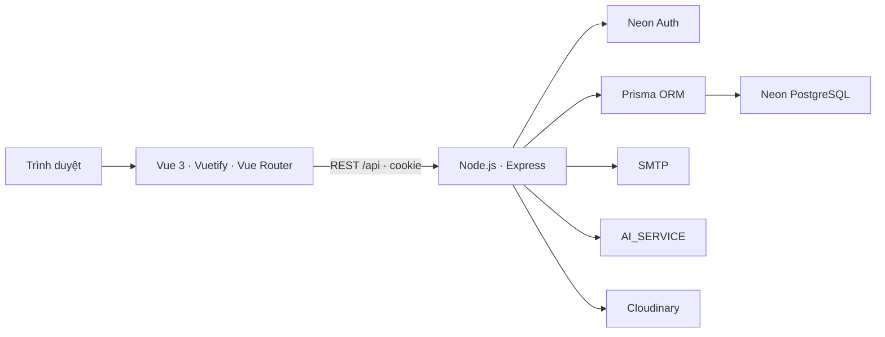

# Kiến trúc hệ thống

Tài liệu tổng hợp thành phần, cách tổ chức backend, ranh giới dữ liệu và cách triển khai. Quy tắc chi tiết từng nghiệp vụ nằm trong [WORKFLOWS.md](../05-business-domain/WORKFLOWS.md).

## 1. Thành phần và luồng xử lý



- `FE/`: giao diện Vue, Vite, Vuetify; gọi API với cookie phiên, quản lý trại đang chọn trong farm context.
- `BE/`: xác thực, kiểm tra quyền/phạm vi, xử lý nghiệp vụ và truy vấn dữ liệu.
- `AI_SERVICE/`: dịch vụ phân tích ảnh riêng; backend gọi qua `AI_SERVICE_URL`.
- Neon Auth quản lý danh tính và phiên đăng nhập. Prisma quản lý truy cập schema ứng dụng trong PostgreSQL.
- SMTP phục vụ email; Cloudinary phục vụ media theo cấu hình của từng dịch vụ.

Frontend không giữ `DATABASE_URL`, khóa SMTP hoặc bí mật của dịch vụ ngoài. Cấu hình mẫu xem `FE/.env.example`, `BE/.env.example` và `AI_SERVICE/.env.example` trong repository.

## 2. Tổ chức backend theo nghiệp vụ

```text
BE/src/
├── routes/<domain>/<feature>/
│   ├── index.js
│   └── get.js / post.js / patch.js / delete.js
├── controllers/<domain>/<feature>/
│   ├── index.js
│   └── get.js / post.js / patch.js / delete.js
├── services/<domain>/<feature>.service.js
├── config/
├── middlewares/
└── utils/
```

| Nhóm thư mục | Phạm vi |
| --- | --- |
| `auth` | Đăng nhập, phiên, truy cập tài khoản, OTP và mật khẩu |
| `users` | Người dùng và phân công thành viên |
| `farms` | Trang trại, khu vực, ao/bể |
| `seed` | Lô giống, nhà cung cấp, kiểm định và lịch sử chất lượng |
| `care` | Nhật ký chăm sóc, cho ăn, nước, xử lý và báo cáo |
| `inventory` | Danh mục, yêu cầu và giao dịch vật tư |
| `sales` | Khách hàng và đơn bán giống |
| `environment` | Ngưỡng, cảnh báo, phân công xử lý và thông báo cá nhân |
| `notifications` | Dịch vụ gửi email dùng chung trong lớp service |

Luồng HTTP: **route → middleware → controller → service → Prisma/dịch vụ ngoài**.

- Route khai báo URL và middleware. Trong từng chức năng, file theo phương thức HTTP chứa phần tương ứng; `index.js` ghép thành router và giữ đúng thứ tự middleware/endpoint.
- Controller ánh xạ request sang dữ liệu đầu vào; trả JSON và mã HTTP. Handler được tách vào `get.js`, `post.js`, `put.js`, `patch.js`, `delete.js` theo phương thức thực tế; `index.js` xuất các handler để route sử dụng. Không tạo file cho phương thức chưa dùng.
- Service nhận dữ liệu thuần như `farmId`, `actor`, `membership`, `input`, `filters`; xử lý quy tắc, phạm vi, transaction và khóa đồng thời. Không nhận Express `req`/`res`, không gửi HTTP response, không import controller.
- `config/` khởi tạo client và cấu hình ngoài; Neon client nằm tại `config/neon-auth.js`.
- `middlewares/` xử lý ngữ cảnh HTTP, xác thực, quyền và lỗi; cookie Neon đi qua `auth-context.js`.
- `utils/` chứa validation và hàm dùng chung.

Tên file mô tả ngắn chức năng, ví dụ `WaterParameters.vue`, `BatchForm.vue`, `useInventory.js`; tránh tên chung như `Params`, `Form`, `usePage`. Giữ `index.vue`/`index.js` làm file đầu mối của trang hoặc module, nơi ghép các thành phần liên quan. Giữ tên chuẩn do công cụ quy định như `main.js`, `server.js`, `Dockerfile`.

Service giữ logic nghiệp vụ dùng chung, không tách theo phương thức HTTP. Các file cùng nghiệp vụ nằm trong cùng nhóm ở từng lớp. Khi gọi chéo nhóm, dùng đường dẫn import rõ ràng. Không tạo bản sao tương thích hoặc thư mục `src/auth/`, `src/users/` song song với cấu trúc này.

## 3. Trại, thành viên và phân quyền

- `users` là danh tính; `farms` là ranh giới dữ liệu trang trại.
- `farm_members` xác định `role`, `status` và `area_id` của người dùng tại trại.
- Năm vai trò: `owner`, `farm_manager`, `area_manager`, `technician`, `warehouse_staff`.
- Quản lý trại làm việc toàn trại được phân công; quản lý khu vực và kỹ thuật viên bị giới hạn thêm theo khu vực. Quyền cụ thể tiếp tục phụ thuộc nghiệp vụ.
- `ADMIN_EMAIL` xác định tài khoản quản trị toàn hệ thống qua email đã xác thực; không thêm role `admin` vào membership.
- Mọi thao tác phải xác minh trại, trạng thái truy cập và phạm vi trước khi đọc/ghi. Không tin role hoặc khu vực do frontend tự khai báo.
- Dữ liệu nghiệp vụ phải có `farm_id` trực tiếp hoặc truy ngược chắc chắn về trại qua quan hệ cha.

Mô hình dữ liệu có membership theo trại không có nghĩa mọi vai trò đều được tham gia nhiều trại. Chính sách nhiều trại/lời mời phải đối chiếu code, constraint và quyết định nghiệp vụ.

## 4. Chạy cục bộ và triển khai

Từ thư mục gốc, sau khi cấu hình môi trường:

```bash
docker compose up --build
```

`docker-compose.yml` chứa cấu hình phát triển: frontend chạy Vite tại `http://localhost:5173`, backend chạy nodemon tại cổng `8000`, AI chạy tại cổng `8001`. Các thư mục mã nguồn được mount để tự nạp khi sửa. Backend chạy migration deploy trước khi khởi động trong cấu hình này.

Sau lần build đầu, chạy `docker compose up` để khởi động. File Compose này dùng cho phát triển; frontend chạy Vite. Dockerfile frontend vẫn có các bước build và phục vụ qua Nginx để dùng khi triển khai. Backend có healthcheck `/api/health`. Database dùng Neon PostgreSQL bên ngoài, không tạo container PostgreSQL.

Có thể triển khai frontend lên Vercel và backend lên Render khi cấu hình đúng URL API, CORS, cookie và biến môi trường. Đây là phương án triển khai, không phải xác nhận hệ thống đã được deploy lên các nền tảng này. Đặt `VITE_API_URL` khi build frontend; giữ database và secret tại backend. AI là dịch vụ riêng mà backend phải truy cập được.

Trong môi trường backend chạy ngoài Compose, các lệnh chuẩn trong `BE/` là:

```bash
npm run prisma:generate
npm run migrate:deploy
npm start
```

`prisma:generate` tạo Prisma Client; `migrate:deploy` áp dụng migration chưa chạy; `start` khởi động API. Không sửa migration đã triển khai. Schema hiện hành xem [schema.prisma](../../BE/prisma/schema.prisma); hướng dẫn vận hành đầy đủ xem [README dự án](../../README.md).
