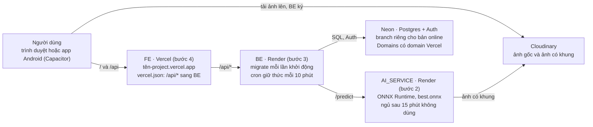

# Hướng dẫn deploy ChillShrimp_GROUP

Hướng dẫn này đưa repo nhóm [Mon0205/ChillShrimp_GROUP](https://github.com/Mon0205/ChillShrimp_GROUP) lên các gói miễn phí: AI_SERVICE và BE trên Render, FE trên Vercel, database và đăng nhập trên Neon, kèm app Android build bằng Capacitor. Mọi bước đã được làm thử thành công trên bản deploy ChillShrimp v2 ([noat04/chillshrimp-deploy-v2](https://github.com/noat04/chillshrimp-deploy-v2)), đang chạy tại https://chillshrimp-deploy-v2.vercel.app.

Làm theo đúng thứ tự, vì bước sau cần URL hoặc trạng thái của bước trước:

1. **Bước 0:** đưa các thay đổi phục vụ deploy vào repo nhóm. Repo hiện tại chưa deploy được nguyên trạng.
2. **Bước 1:** chuẩn bị tài khoản, biến môi trường, database.
3. **Bước 2–4:** deploy AI → BE → FE.
4. **Bước 5:** build app Android.

Các tên service, domain trong tài liệu là của bản v2 để tham khảo; khi deploy repo nhóm, thay bằng tên của nhóm.

## Kiến trúc sau khi deploy



Trình duyệt và app chỉ gọi domain Vercel, nên cookie đăng nhập luôn cùng domain. Ảnh người dùng chụp đi thẳng lên Cloudinary bằng chữ ký BE cấp; khi bấm Phân tích, BE tải ảnh về và gọi AI_SERVICE. Mỗi hộp ghi bước tạo ra nó trong hướng dẫn.

## Bước 0: Đưa thay đổi deploy vào repo nhóm

Trạng thái repo nhóm (kiểm tra ngày 18/11/2026):

- **`master` đã có bản AI mới.** Commit `27952f4` đã merge `feature/ai-service` vào `master`, nên `master` đã có YOLO26s, cảnh báo ảnh, số đếm tay (commit `d6aacb5`) và migration `20261110_001_add_ai_inspection_photo_warnings`.
- **Repo chưa có các file deploy.** `AI_SERVICE/requirements.txt` vẫn dùng `ultralytics` (PyTorch), `BE/Dockerfile` chưa cài OpenSSL, chưa có `FE/vercel.json` và Capacitor. Repo deploy v2 được tạo từ chính commit `d6aacb5`, rồi thêm 31 file (14 file mới, 17 file sửa):

| Phần | Thay đổi | Lý do |
|---|---|---|
| AI_SERVICE | Chạy model bằng ONNX Runtime: `app/detector.py`, `models/best.onnx`, `scripts/export_onnx.py`, sửa `app/main.py`, `requirements.txt`, `Dockerfile` (nghe cổng `$PORT`), thêm `.dockerignore` | Chạy bằng PyTorch dùng 482–549 MB RAM, vượt 512 MB của Render Free; ONNX chỉ 264–333 MB và cùng số con trên 138/138 lần chạy thử |
| BE | `Dockerfile` cài OpenSSL | Image Alpine thiếu OpenSSL nên Prisma không nạp được engine trên Render |
| BE | `server.js`, `ai-inspection.service.js`, `BE/test/` | Khi BE khởi động lại, lần kiểm tra AI đang dở được chuyển sang `failed` thay vì kẹt mãi ở `processing`; Render Free hay khởi động lại |
| FE | `vercel.json` | Chuyển `/api/*` sang BE trên Render để cookie đăng nhập cùng domain |
| FE | Capacitor: `android/`, `capacitor.config.ts`, `package.json`, `package-lock.json`, `src/services/camera.js`, 3 file trong `pages/seed-batches` | App Android và nút Chụp ảnh ở trang Kiểm tra AI |
| FE | `public/manifest.json`, `public/icons/`, `index.html`, `.dockerignore` | Icon app và manifest PWA |
| Chung | `docker-compose.yml` (model `best.onnx`), `.gitignore` (`.vercel/`, `*.keystore`, `*.jks`), `docs/02-architecture/DEPLOY.md` | Chạy local giống bản online; không commit nhầm khóa ký APK |

**Cách đưa vào repo nhóm.** Repo deploy v2 đang để riêng tư, nên bước này do người có quyền vào cả hai repo thực hiện (hoặc mời thành viên vào repo v2). Chạy trong PowerShell, ở thư mục repo nhóm:

```powershell
git fetch origin
git checkout -b deploy origin/master
git remote add deploy-v2 https://github.com/noat04/chillshrimp-deploy-v2.git
git fetch deploy-v2
# Chép đúng các file deploy từ v2 (không đụng tới file khác)
git checkout deploy-v2/main -- .gitignore docker-compose.yml docs AI_SERVICE BE/Dockerfile BE/src/server.js BE/src/services/seed/ai-inspection.service.js BE/test FE/.dockerignore FE/index.html FE/package.json FE/package-lock.json FE/capacitor.config.ts FE/vercel.json FE/public FE/android FE/src/services/camera.js FE/src/pages/seed-batches
git status          # kiểm tra không có file .env nào
git commit -m "Deploy: ONNX AI service, OpenSSL for Prisma, Vercel and Capacitor"
git push -u origin deploy
```

`git checkout <nhánh> -- <đường dẫn>` chép file từ repo v2 sang mà không trộn lịch sử, nên dùng được dù hai repo không chung gốc. Sau đó mở pull request `deploy` → `master` để cả nhóm duyệt; Render và Vercel nên theo dõi nhánh `master` sau khi merge (hoặc nhánh `deploy` nếu muốn thử trước).

Nếu nhóm sửa code sau ngày 15/11, kiểm tra kỹ 3 file `BatchInspection.vue`, `useBatchInspection.js`, `useSeedBatches.js` trước khi chép, vì lệnh trên ghi đè toàn bộ thư mục `pages/seed-batches`. Đến ngày 18/11/2026 chưa có commit nào sửa các file bị ghi đè.

## Bước 1: Chuẩn bị

**Tài khoản.** Đăng nhập [Render](https://render.com) và [Vercel](https://vercel.com) bằng GitHub. Repo nhóm thuộc tài khoản `Mon0205`, nên chủ repo phải cấp quyền cho GitHub App của Render và Vercel đọc repo này, hoặc chính chủ repo tạo các service. Không có quyền này thì repo sẽ không hiện trong danh sách khi tạo service.

**Giá trị cần có** (lấy từ `BE/.env` và `AI_SERVICE/.env` trên máy; không bao giờ commit hai file này):

| Giá trị | Lấy ở đâu |
|---|---|
| `CLOUDINARY_CLOUD_NAME`, `CLOUDINARY_API_KEY`, `CLOUDINARY_API_SECRET` | Cloudinary Console → Dashboard |
| `DATABASE_URL` | Neon Console → branch đã chọn → Connect, giữ `sslmode=require` |
| `NEON_AUTH_URL` | Neon Console → Settings → Better Auth → Auth URL của cùng branch |
| `NEON_AUTH_COOKIE_SECRET` | Tạo mới, không dùng giá trị mẫu `replace-with-...`: `node -e "console.log(require('crypto').randomBytes(32).toString('base64'))"` |
| `SMTP_HOST`, `SMTP_PORT`, `SMTP_USER`, `SMTP_PASS`, `SMTP_FROM` | Gmail App Password của nhóm (gửi email mời) |
| `ADMIN_EMAIL` | Email tài khoản quản trị toàn hệ thống |

**Database.** BE tự chạy `migrate deploy` mỗi lần khởi động, nên database phải ở trạng thái migration sạch; nếu có migration lỗi, BE sẽ không lên. Nhóm chọn một trong hai:

| Cách | Ưu điểm | Nhược điểm |
|---|---|---|
| Dùng branch hiện tại `nofication-test` | Đã đủ 47 migration, có sẵn tài khoản và dữ liệu, Neon Auth đã cấu hình | Bản online, bản v2 và máy của các thành viên cùng ghi vào một database; chạy thử trên máy có thể làm hỏng dữ liệu demo |
| Tạo branch riêng (khuyến nghị): Neon Console → Branches → Create branch từ branch hiện tại | Bản online tách biệt; branch mới có sẵn dữ liệu và migration tại thời điểm tạo | Phải lấy `DATABASE_URL` và kiểm tra Auth URL của branch mới; tài khoản tạo sau chỉ nằm trên branch đó |

Kiểm tra migration trước khi deploy BE (PowerShell, thư mục `BE` của nhánh `deploy`):

```powershell
$env:DATABASE_URL = "<chuỗi kết nối của branch đã chọn>"
npm ci --legacy-peer-deps
node scripts/migrate.js status   # phải báo "Database schema is up to date"
```

## Bước 2: Deploy AI_SERVICE lên Render

Render → **New → Web Service** → chọn repo nhóm, rồi điền:

| Mục | Giá trị |
|---|---|
| Name | Ví dụ `chillshrimp-ai` (tên này thành địa chỉ `https://<name>.onrender.com`) |
| Region | Singapore |
| Branch | `deploy` (hoặc `master` sau khi merge) |
| Root Directory | `AI_SERVICE` |
| Language | **Docker** |
| Instance Type | Free |
| Health Check Path (mục Advanced) | `/health` |

Biến môi trường:

| Biến | Giá trị |
|---|---|
| `CLOUDINARY_CLOUD_NAME`, `CLOUDINARY_API_KEY`, `CLOUDINARY_API_SECRET` | Như `AI_SERVICE/.env` |
| `MODEL_VERSION` | `v8_yolo26s_seed0_onnx` (BE lưu giá trị này vào từng lần kiểm tra) |
| `DETECTION_CONF`, `CROWD_OVERLAP_RATIO_MAX`, `CROWD_COVERAGE_MAX` | Tùy chọn; mặc định 0.35, 0.25, 0.30 |

Không đặt `PORT`, `MODEL_PATH`, `ORT_NUM_THREADS`: Render tự cấp cổng, Dockerfile đã đặt hai biến còn lại.

Bấm Deploy, chờ khoảng 5–10 phút. Kiểm tra:

- Mở `https://<name>.onrender.com/health`: phải thấy `"model_exists": true` và `"cloudinary_configured": true`.
- Mở `/docs`, gọi thử `POST /predict` với `Demo_anh_mau/anh_dat_chuan.jpg`: kết quả 108 con (ngưỡng mặc định 0,35).

Ghi lại địa chỉ AI để dùng ở bước 3.

## Bước 3: Deploy BE lên Render

Tạo thêm một Web Service giống bước 2, khác các mục sau:

| Mục | Giá trị |
|---|---|
| Name | Ví dụ `chillshrimp-be` |
| Root Directory | `BE` |
| Language | **Docker** |
| Health Check Path | `/api/health` |

Biến môi trường:

| Biến | Giá trị |
|---|---|
| `DATABASE_URL` | Chuỗi kết nối của branch đã chọn ở bước 1 |
| `NEON_AUTH_URL` | Auth URL của cùng branch |
| `NEON_AUTH_COOKIE_SECRET` | Chuỗi ngẫu nhiên vừa tạo |
| `AI_SERVICE_URL` | `https://<tên AI>.onrender.com` (không có `/` cuối) |
| `FRONTEND_URL` | Tạm để `https://example.com`, sửa ở bước 4 |
| `CLOUDINARY_CLOUD_NAME`, `CLOUDINARY_API_KEY`, `CLOUDINARY_API_SECRET` | Như `BE/.env` |
| `SMTP_HOST`, `SMTP_PORT`, `SMTP_USER`, `SMTP_PASS`, `SMTP_FROM` | Như `BE/.env` |
| `ADMIN_EMAIL` | Email quản trị |

Không đặt `PORT` (Render tự cấp) và `ADMIN_PASSWORD` (chỉ dùng khi chạy `npm run seed:admin` trên máy).

Khi khởi động, container chạy `node scripts/migrate.js deploy` rồi mới chạy server. Kiểm tra:

- Tab **Logs** có dòng `Applying Prisma migrations...` và không báo lỗi `P3009`.
- Mở `https://<tên BE>.onrender.com/api/health`: thấy `{"data":{"status":"ok"}}`.

## Bước 4: Deploy FE lên Vercel và nối với BE

1. **Sửa `FE/vercel.json`.** Sau bước 0, file này vẫn trỏ tới BE của bản v2 (`chillshrimp-be.onrender.com`). Đổi thành tên BE của nhóm rồi commit, push:

   ```json
   {
     "rewrites": [
       { "source": "/api/:path*", "destination": "https://<tên BE>.onrender.com/api/:path*" },
       { "source": "/(.*)", "destination": "/index.html" }
     ]
   }
   ```

2. **Tạo project trên Vercel.** Add New → Project → import repo nhóm. Root Directory `FE`, Framework **Vite** (Build `npm run build`, Output `dist`), biến môi trường `VITE_API_URL` = `/api`. Nếu deploy từ nhánh `deploy`, đổi Production Branch trong Settings → Git. Bấm Deploy và chép domain nhận được, ví dụ `https://<project>.vercel.app`.
3. **Sửa `FRONTEND_URL` của BE.** Render → service BE → Environment (hoặc Settings → Environment Variables) → Edit → đổi thành domain Vercel, không có `/` cuối → **Save and deploy**. Biến này dùng cho CORS, link trong email mời và Origin khi gửi OTP.
4. **Thêm domain vào Neon Auth.** Neon Console → chọn đúng branch BE đang dùng → Settings → Better Auth → Domains → nhập `https://<project>.vercel.app` → **Add domain**. Thiếu bước này thì mọi lần đăng nhập đều báo "Email hoặc mật khẩu không đúng" dù nhập đúng.
5. **Đăng nhập thử** trên domain Vercel.
6. **Giữ BE thức.** Tạo job trên [cron-job.org](https://cron-job.org) gọi `https://<tên BE>.onrender.com/api/health` 10 phút một lần. Không giữ AI thức 24/7: gói Free có 750 giờ chạy mỗi tháng cho cả tài khoản, chỉ đủ cho một dịch vụ chạy liên tục.

## Bước 5: Build app Android bằng Capacitor

App là một khung WebView mở thẳng trang Vercel (`server.url`), không đóng gói file giao diện, vì cookie đăng nhập Neon Auth chỉ hoạt động khi trang và `/api` cùng domain. Hệ quả: sửa FE và deploy lại Vercel là app tự cập nhật; chỉ build lại APK khi đổi domain Vercel hoặc cấu hình Android (quyền, icon, plugin). App cần Internet.

Cần JDK 21 và Android SDK (cài kèm Android Studio). Chạy trong thư mục `FE`:

```powershell
npm ci
$env:CAP_SERVER_URL = "https://<project>.vercel.app"   # bắt buộc https://
npm run mobile:sync                                     # vite build + cap sync android
cd android
.\gradlew.bat assembleDebug
# APK: FE\android\app\build\outputs\apk\debug\app-debug.apk (khoảng 11 MB)
```

Quên đặt `CAP_SERVER_URL` thì app mở bản đóng gói và không đăng nhập được. Cách khác: `npm run mobile:open` rồi build trong Android Studio (Build → Build APK(s)).

**Cài và thử:** gửi file APK sang điện thoại, cho phép cài ứng dụng không rõ nguồn gốc, mở app, đăng nhập, vào Lô giống → Kiểm tra AI → **Chụp ảnh**. Lần đầu app xin quyền camera. Xem lỗi bên trong app bằng Chrome trên máy tính: bật Gỡ lỗi USB trên điện thoại, cắm cáp, mở `chrome://inspect`.

APK debug chỉ để thử và demo. Phát hành lên Google Play cần bản release ký bằng keystore; file `*.jks`, `*.keystore` đã được loại khỏi git.

## Kiểm tra sau deploy và lỗi thường gặp

- [ ] `/health` của AI trả 200, `model_exists: true`
- [ ] `/api/health` của BE trả 200, Logs không có lỗi migration
- [ ] Đăng nhập được trên domain Vercel, chọn được trại
- [ ] Lô giống → Kiểm tra AI → tải ảnh → Phân tích ra số con và ảnh có khung
- [ ] App Android: đăng nhập, Chụp ảnh, phân tích

Các lỗi dưới đây đều đã gặp thật khi deploy bản v2:

| Hiện tượng | Nguyên nhân | Cách xử lý |
|---|---|---|
| Đăng nhập báo "Email hoặc mật khẩu không đúng" dù nhập đúng; Console có 401 ở `/api/auth/login` | Domain Vercel chưa có trong Domains của Neon Auth: Neon trả 403, BE gộp mọi lỗi đăng nhập thành 401 | Thêm domain ở bước 4.4, đúng branch BE đang dùng. Nếu vẫn lỗi thì kiểm tra lại mật khẩu: mật khẩu trong `.env` có thể đã cũ |
| Bấm Phân tích nhận 502, lần kiểm tra sau đó vẫn ra kết quả | AI đang ngủ, lần đầu mất khoảng 76 giây; proxy `/api` của Vercel ngắt trước nhưng BE vẫn xử lý xong | Tải lại danh sách kiểm tra. Trước demo, mở `/health` của AI trước vài phút |
| Bấm Phân tích nhận 502, lần kiểm tra chuyển sang Lỗi | BE gọi AI đúng lúc AI đang khởi động lại | Chờ AI thức rồi bấm Phân tích lại; ảnh gốc vẫn còn |
| BE không lên, Logs báo `P3009` | Database có migration chạy lỗi dở | Sửa migration, chạy `npx prisma migrate resolve --rolled-back <tên migration>` với `DATABASE_URL` của branch đó, rồi deploy lại |
| BE không lên, Logs báo lỗi nạp Prisma engine hoặc `libssl` | Dockerfile BE thiếu OpenSSL | Kiểm tra `BE/Dockerfile` đã có `RUN apk add --no-cache openssl` (bước 0) |
| AI bị Render tắt vì hết bộ nhớ | Vẫn chạy bản PyTorch, hoặc ảnh rất lớn (ảnh 12 MP dùng khoảng 450 MB) | Kiểm tra `AI_SERVICE/requirements.txt` không còn `ultralytics` (bước 0) |
| FE gọi nhầm BE của bản v2 | Chưa sửa `FE/vercel.json` | Làm bước 4.1 rồi push |
| `gradlew.bat` báo `Unable to access jarfile` | Đường dẫn có dấu tiếng Việt (`ĐỒ ÁN TỐT NGHIỆP`) | Tạo đường dẫn không dấu rồi build từ đó, ví dụ trong PowerShell: `New-Item -ItemType Junction -Path C:\cs -Target "<thư mục repo>"`, rồi `cd C:\cs\FE\android`. Hoặc build bằng Android Studio |
| App mở được nhưng không đăng nhập được | Build thiếu `CAP_SERVER_URL` nên app chạy bản đóng gói | Đặt biến rồi chạy lại `npm run mobile:sync` và build |

Nguồn: repo [noat04/chillshrimp-deploy-v2](https://github.com/noat04/chillshrimp-deploy-v2) (riêng tư), file `docs/02-architecture/DEPLOY.md` và `AI_SERVICE/README.md` trong repo đó.
