# Sơ đồ cơ sở dữ liệu

Schema ứng dụng hiện tại: **19 bảng**. Nguồn: [schema.prisma](../../BE/prisma/schema.prisma). [Công dụng từng field](./DATABASE-FIELDS.md). Chưa xác nhận migration trên DB đang chạy.

```mermaid
erDiagram
    users {
        text id PK
        text email UK
        text username UK "nullable"
        text displayName "nullable"
        text phone "nullable"
        timestamptz created_at
        timestamptz updated_at
    }
    farms {
        uuid id PK
        text code UK
        text name
        text address "nullable"
        varchar status
        text created_by FK
        timestamptz created_at
        timestamptz updated_at
    }
    areas {
        uuid id PK
        uuid farm_id FK
        text code
        text name
        varchar status
        timestamptz created_at
        timestamptz updated_at
    }
    ponds_tanks {
        uuid id PK
        uuid farm_id FK
        uuid area_id FK "nullable"
        text responsible_user_id FK "nullable"
        varchar code
        varchar name
        varchar tank_type
        numeric volume_m3
        varchar status
        text description "nullable"
        text deleted_by FK "nullable"
        timestamptz deleted_at "nullable"
        timestamptz created_at
        timestamptz updated_at
    }
    feeding_logs {
        uuid id PK
        uuid tank_id FK
        text performed_by FK
        uuid supply_id FK "nullable"
        varchar feed_name
        numeric amount
        varchar unit
        varchar feed_check_status "nullable"
        timestamptz feeding_time
        text notes "nullable"
        timestamptz created_at
    }
    water_change_logs {
        uuid id PK
        uuid tank_id FK
        text performed_by FK
        numeric water_change_percentage
        timestamptz performed_at
        text notes "nullable"
        timestamptz created_at
    }
    water_parameter_logs {
        uuid id PK
        uuid tank_id FK
        text recorded_by FK
        numeric temperature "nullable"
        numeric ph "nullable"
        numeric salinity "nullable"
        numeric dissolved_oxygen "nullable"
        numeric nh3 "nullable"
        numeric tan "nullable"
        numeric no2 "nullable"
        numeric nitrate "nullable"
        numeric alkalinity "nullable"
        numeric h2s "nullable"
        numeric turbidity "nullable"
        numeric water_level_m "nullable"
        varchar measurement_method
        varchar measurement_device "nullable"
        timestamptz recorded_at
        text notes "nullable"
        timestamptz created_at
    }
    environment_thresholds {
        uuid id PK
        uuid farm_id FK
        varchar species
        varchar development_stage
        varchar tank_type
        varchar parameter_code
        varchar unit
        numeric optimal_min "nullable"
        numeric optimal_max "nullable"
        numeric warning_min "nullable"
        numeric warning_max "nullable"
        numeric danger_min "nullable"
        numeric danger_max "nullable"
        date effective_from
        date effective_to "nullable"
        boolean is_active
        text created_by FK
        text approved_by FK "nullable"
        timestamptz approved_at "nullable"
        timestamptz created_at
        timestamptz updated_at
    }
    alerts_notifications {
        uuid id PK
        uuid farm_id FK
        uuid batch_id FK "nullable"
        uuid tank_id FK "nullable"
        uuid threshold_id FK "nullable"
        uuid source_log_id FK "nullable"
        varchar parameter_code "nullable"
        numeric observed_value "nullable"
        varchar alert_type
        varchar severity
        varchar title
        text message
        boolean is_read
        timestamptz created_at
    }
    treatment_logs {
        uuid id PK
        uuid tank_id FK
        text performed_by FK
        uuid supply_id FK "nullable"
        varchar product_name
        numeric amount
        varchar unit
        text purpose
        timestamptz performed_at
        text notes "nullable"
        timestamptz created_at
    }
    inventory_supplies {
        uuid id PK
        uuid farm_id FK
        varchar name
        varchar category
        varchar unit
        numeric quantity
        numeric unit_price
        numeric min_threshold
        text description "nullable"
        timestamptz created_at
        timestamptz updated_at
    }
    inventory_transactions {
        uuid supply_request_id UK "nullable"
        uuid id PK
        uuid supply_id FK
        uuid batch_id FK "nullable"
        text created_by FK
        varchar transaction_type
        numeric quantity
        numeric unit_price
        timestamptz transaction_date
        text notes "nullable"
        timestamptz created_at
    }
    supply_requests {
        text processed_by FK "nullable"
        timestamptz processed_at "nullable"
        text rejection_reason "nullable"
        uuid tank_id FK "nullable for legacy records"
        uuid id PK
        uuid farm_id FK
        uuid supply_id FK
        uuid area_id FK "nullable"
        text requested_by FK
        numeric quantity
        varchar status
        text notes "nullable"
        timestamptz created_at
        timestamptz updated_at
    }
    seed_suppliers {
        uuid id PK
        uuid farm_id FK
        varchar name
        varchar phone "nullable"
        text address "nullable"
    }
    seed_batches {
        uuid id PK
        uuid tank_id FK
        uuid supplier_id FK "nullable"
        varchar batch_code UK
        varchar species
        varchar development_stage
        integer initial_quantity
        integer current_estimated_quantity
        date stocked_date
        date expected_sale_date
        varchar status
        text notes "nullable"
        timestamptz created_at
        timestamptz updated_at
    }
    ai_inspections {
        uuid id PK
        uuid batch_id FK
        text created_by FK
        text media_url
        varchar media_public_id UK
        text annotated_image_url "nullable"
        varchar sampling_method
        numeric sample_volume_ml "nullable"
        integer manual_count "nullable"
        integer detected_count "nullable"
        numeric density_per_ml "nullable"
        numeric correction_factor "nullable"
        numeric average_confidence "nullable"
        numeric average_size_mm "nullable"
        numeric uniformity_score "nullable"
        jsonb detections "nullable"
        varchar model_version "nullable"
        varchar status
        timestamptz inspected_at "nullable"
        text notes "nullable"
        timestamptz created_at
    }
    farm_members {
        uuid farm_id FK
        text user_id FK
        FarmRole role
        MembershipStatus status
        uuid area_id FK "nullable"
        timestamptz created_at
    }
    farm_invitations {
        uuid id PK
        uuid farm_id FK
        text invited_user_id FK "nullable"
        text email
        FarmRole role
        uuid area_id FK "nullable"
        text invited_by
        text token_hash UK
        timestamptz expires_at
        InvitationStatus status
        timestamptz created_at
        timestamptz accepted_at "nullable"
    }
    password_reset_otp_windows {
        text email PK
        timestamptz expires_at
        timestamptz created_at
        timestamptz updated_at
    }
    users ||--o{ farms : "created_by"
    farms ||--o{ areas : "farm_id"
    farms ||--o{ ponds_tanks : "farm_id"
    areas |o--o{ ponds_tanks : "area_id"
    users |o--o{ ponds_tanks : "deleted_by"
    users |o--o{ ponds_tanks : "responsible_user_id"
    ponds_tanks ||--o{ feeding_logs : "tank_id"
    users ||--o{ feeding_logs : "performed_by"
    inventory_supplies |o--o{ feeding_logs : "supply_id"
    ponds_tanks ||--o{ water_change_logs : "tank_id"
    users ||--o{ water_change_logs : "performed_by"
    ponds_tanks ||--o{ water_parameter_logs : "tank_id"
    users ||--o{ water_parameter_logs : "recorded_by"
    farms ||--o{ environment_thresholds : "farm_id"
    users ||--o{ environment_thresholds : "created_by"
    users |o--o{ environment_thresholds : "approved_by"
    farms ||--o{ alerts_notifications : "farm_id"
    seed_batches |o--o{ alerts_notifications : "batch_id"
    ponds_tanks |o--o{ alerts_notifications : "tank_id"
    environment_thresholds |o--o{ alerts_notifications : "threshold_id"
    water_parameter_logs |o--o{ alerts_notifications : "source_log_id"
    ponds_tanks ||--o{ treatment_logs : "tank_id"
    users ||--o{ treatment_logs : "performed_by"
    inventory_supplies |o--o{ treatment_logs : "supply_id"
    farms ||--o{ inventory_supplies : "farm_id"
    supply_requests |o--o{ inventory_transactions : "supply_request_id"
    inventory_supplies ||--o{ inventory_transactions : "supply_id"
    seed_batches |o--o{ inventory_transactions : "batch_id"
    users ||--o{ inventory_transactions : "created_by"
    farms ||--o{ supply_requests : "farm_id"
    inventory_supplies ||--o{ supply_requests : "supply_id"
    areas |o--o{ supply_requests : "area_id"
    users ||--o{ supply_requests : "requested_by"
    farms ||--o{ seed_suppliers : "farm_id"
    ponds_tanks ||--o{ seed_batches : "tank_id"
    seed_suppliers |o--o{ seed_batches : "supplier_id"
    seed_batches ||--o{ ai_inspections : "batch_id"
    users ||--o{ ai_inspections : "created_by"
    farms ||--o{ farm_members : "farm_id"
    users ||--o{ farm_members : "user_id"
    areas |o--o{ farm_members : "area_id"
    farms ||--o{ farm_invitations : "farm_id"
    users |o--o{ farm_invitations : "invited_user_id"
    areas |o--o{ farm_invitations : "area_id"
    ponds_tanks |o--o{ supply_requests : "tank_id"
    users |o--o{ supply_requests : "processed_by"
```

